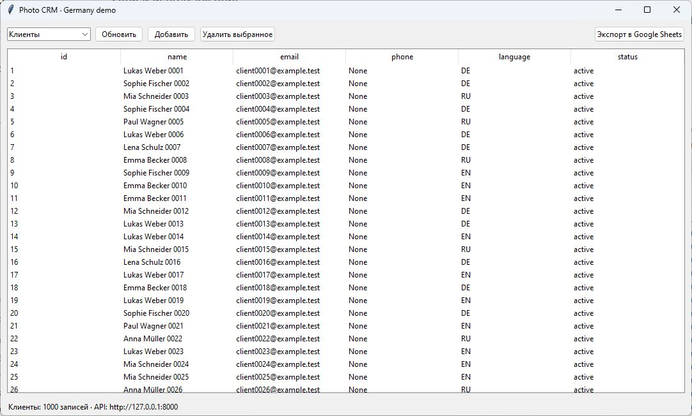
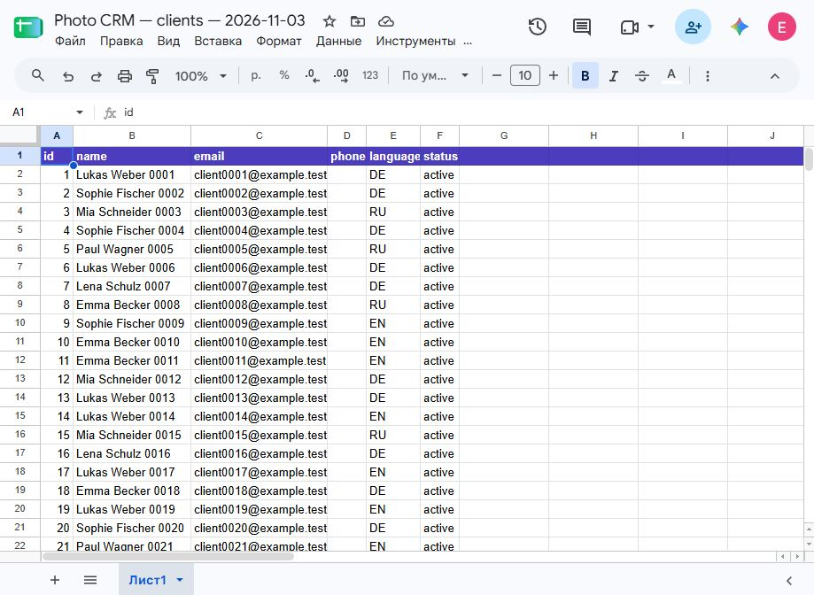
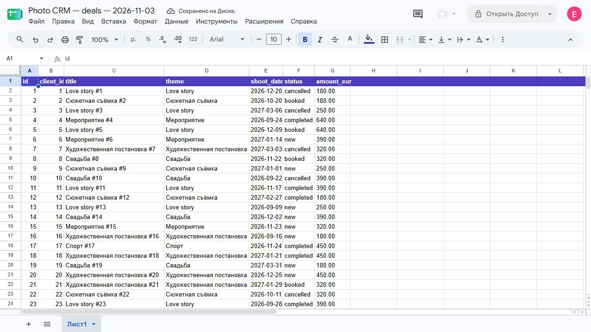
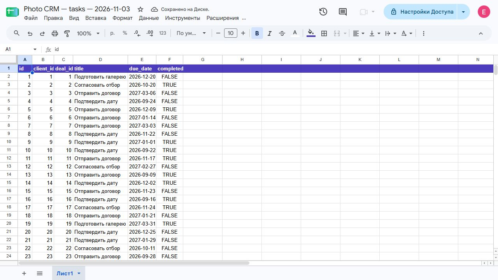
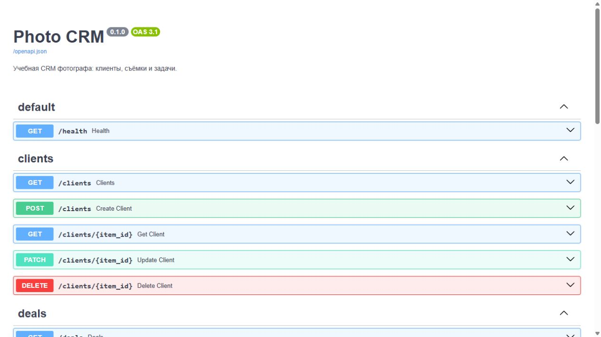

# VPh03 — Мини-CRM фотографа

## Задание и связь с проектом

По уроку VPh03: создать CRM с API для клиентов, сделок и задач, использовать Google Drive и Google Sheets, пользовательский OAuth, Docker Compose и тестовые данные; выгрузить отчёты и подтвердить доступ к ним ссылками.

Эта работа продолжает `photographer-site` — учебный демонстрационный продукт фотографа в Германии. Связанный VPh02 формирует финансовый отчёт; VPh03 добавляет CRM-сущности и выгрузки. Решение ориентировано на зарубежных заказчиков; такой подход может не подойти для российского рынка.

## Реализация

- FastAPI CRUD для клиентов, съёмок и задач, включая поиск, пагинацию, обновление отдельных полей и проверку связей.
- SQLAlchemy и PostgreSQL в Docker Compose; SQLite допустим для локальных проверок.
- Tkinter-клиент для просмотра, создания и удаления записей.
- Повторяемый генератор синтетических записей (до 10 000) с немецким рынком, языками DE/EN/RU и суммами в EUR.
- Экспорт трёх отдельных Google Sheets от имени пользователя через OAuth Desktop Client.
- OAuth client JSON и выданный токен исключены из Git.

## Фактический статус

Проверено Codex 2026-11-03:

- Ранее прошли 2 API-теста на SQLite in-memory, синтаксическая проверка 13 Python-файлов и smoke-прогон SQLite API. Повторный запуск генератора не создавал дубликаты.
- Docker Compose поднял PostgreSQL и API; БД прошла healthcheck. Демо-генератор создал 1000 клиентов, 1000 съёмок и 1000 задач. `/health` ответил `ok`, все три endpoint вернули по 1000 записей, Swagger `/docs` ответил HTTP 200.
- OAuth Desktop Client авторизован от имени `аккаунта владельца проекта` с единственным scope `drive.file`. Локальный `config/token.json` игнорируется Git.
- Созданы и сохранены в Google Drive три таблицы; в каждой выгружено по 1000 записей:
  - [Клиенты](https://docs.google.com/spreadsheets/d/1zLC_Tfa1WEnF6Cq4c4XKglmGuPSbXTuWqATKN0BzvkY/edit)
  - [Съёмки](https://docs.google.com/spreadsheets/d/1pgLtXjPZV54I_m6un-yKVh8654_9IS3u-25kwguEdLo/edit)
  - [Задачи](https://docs.google.com/spreadsheets/d/1B8Fjac19zkvDuBGFc5RmlDdIfcNmi6Z5q-ETDFGdmhc/edit)
- Все три Google Sheets открыты и визуально проверены: заголовки, синтетические строки и статус «Сохранено на Диске» отображаются.
- Swagger открыт и визуально проверен; содержит CRUD-операции для клиентов, съёмок и задач.
- Настольное окно Tkinter открыто в интерактивной сессии Windows; отображает 1000 клиентов и подключение к API `http://127.0.0.1:8000`.

## Скриншоты выполнения

### CRM Tkinter

### Google Sheets

### Swagger API

Все пять изображений сняты с фактически работающих CRM, Swagger и Google Sheets; демонстрационные макеты не использовались. Визуальная часть задания подтверждена.

## Источники и решения

- Задание: курс VPh03 «Кейс 2. Мини-CRM на базе вайбкодинга», PDF, предоставленный Евгенией 2026-11-03; исходник курса в репозиторий не копировался.
- Контекст продукта: [`../README.md`](../README.md), [`../STATE.md`](../STATE.md) и [беседа Claude](../../../../conversations/claude/b5d2fd19-a4c1-4506-8067-b95822980fc8/conversation.md).
- Выбор пользовательского OAuth нужен для создания файлов в Drive от имени пользователя; service account VPh02 не используется как OAuth-клиент.
- Реальные клиентские сведения не включать: для учебного прогона используются только вымышленные данные.
